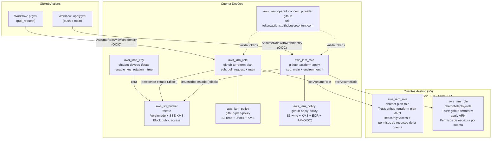

# Design Document — Spec: foundation

## Overview

El spec **foundation** establece los cimientos del repositorio de infraestructura para la plataforma del agente conversacional. Comprende tres entregables principales:

1. **Estructura de directorios** del repositorio, con todas las carpetas y archivos necesarios para los specs posteriores.
2. **Bootstrap de Terraform** (`infra/bootstrap/`): bucket S3 de estado, CMK, proveedor OIDC de GitHub y roles IAM multicuenta; pensado para ejecutarse una sola vez con credenciales de administrador locales.
3. **Módulo `kms`** (`infra/modules/kms/`): patrón de referencia estructural para todos los módulos reutilizables del proyecto.

Además se crean los archivos de herramientas de calidad (`.tflint.hcl`, `.checkov.yaml`, `.pre-commit-config.yaml`, `.gitignore`) y los ADRs 001 y 002.

**Restricción crítica:** todo el código Terraform debe poder validarse sin credenciales AWS reales. `terraform validate` no requiere credenciales; `terraform test` utiliza `mock_provider "aws" {}`.

---

## Architecture

### Diagrama de bootstrap



---

## Components and Interfaces

### Componente 1: Estructura de directorios

#### Árbol completo

```
sdg-agente-conversacional/
├── .github/
│   └── workflows/
│       ├── pr.yml          # lint + validate + plan (spec: cicd)
│       ├── apply.yml       # apply en push a main (spec: cicd)
│       ├── drift.yml       # detección de drift diario (spec: cicd)
│       └── images.yml      # build/push imágenes ECR (opcional, spec: cicd)
├── .gitignore              # entradas Terraform + preexistentes
├── .tflint.hcl             # configuración TFLint con plugin AWS
├── .checkov.yaml           # configuración Checkov para infra/
├── .pre-commit-config.yaml # hooks: fmt, validate, tflint, checkov, terraform-docs
├── .terraform-docs.yml     # configuración de terraform-docs (formato, secciones)
├── docs/
│   ├── arquitectura/
│   │   ├── README.md
│   │   └── arquitectura-agente-conversacional.md   # diagrama Mermaid LLD (ya existe)
│   ├── adr/
│   │   ├── README.md
│   │   ├── ADR-001-terraform-estructura-repositorio.md
│   │   └── ADR-002-bloqueo-estado-use-lockfile.md
│   ├── costes/
│   │   └── .gitkeep
│   └── inventario/
│       └── .gitkeep
├── infra/
│   ├── bootstrap/
│   │   ├── backend.tf
│   │   ├── iam_policies.tf
│   │   ├── main.tf
│   │   ├── outputs.tf
│   │   ├── providers.tf
│   │   ├── variables.tf
│   │   ├── versions.tf
│   │   ├── README.md
│   │   ├── modules/
│   │   │   └── target-roles/
│   │   │       ├── main.tf
│   │   │       ├── variables.tf
│   │   │       └── versions.tf
│   │   └── tests/
│   │       └── bootstrap_test.tftest.hcl
│   ├── modules/
│   │   ├── alb-oidc/           .gitkeep   (spec: workload-platform)
│   │   ├── aurora-pgvector/    .gitkeep   (spec: workload-platform)
│   │   ├── bedrock-kb/         .gitkeep   (spec: workload-platform)
│   │   ├── budgets/            .gitkeep   (spec: operations-dr)
│   │   ├── central-endpoints/  .gitkeep   (spec: networking)
│   │   ├── dns/                .gitkeep   (spec: networking)
│   │   ├── documents-bucket/   .gitkeep   (spec: workload-platform)
│   │   ├── dynamodb-tracker/   .gitkeep   (spec: workload-platform)
│   │   ├── ecr/                .gitkeep   (spec: operations-dr)
│   │   ├── ecs-platform/       .gitkeep   (spec: workload-platform)
│   │   ├── ecs-service/        .gitkeep   (spec: workload-platform)
│   │   ├── egress-inspection/  .gitkeep   (spec: networking)
│   │   ├── kms/
│   │   │   ├── main.tf
│   │   │   ├── variables.tf
│   │   │   ├── outputs.tf
│   │   │   ├── versions.tf
│   │   │   ├── README.md
│   │   │   └── tests/
│   │   │       └── kms_test.tftest.hcl
│   │   ├── observability/      .gitkeep   (spec: operations-dr)
│   │   ├── powerbi-gateway/    .gitkeep   (spec: workload-platform)
│   │   ├── privatelink-service/ .gitkeep  (spec: workload-platform)
│   │   ├── tgw-hub/            .gitkeep   (spec: networking)
│   │   ├── workload-vpc/       .gitkeep   (spec: workload-platform)
│   └── live/
│       ├── devops/
│       │   └── eu-west-1/      .gitkeep   (spec: operations-dr)
│       ├── dr/
│       │   └── eu-central-1/   .gitkeep   (spec: operations-dr)
│       ├── networking/
│       │   └── eu-west-1/      .gitkeep   (spec: networking)
│       └── workload/
│           ├── dev/            .gitkeep   (spec: workload-platform)
│           ├── pre/            .gitkeep   (spec: workload-platform)
│           └── prod/           .gitkeep   (spec: workload-platform)
└── tests/
    └── .gitkeep
```

Los módulos marcados con `.gitkeep` reciben solo ese archivo en este spec; su implementación completa corresponde al spec indicado entre paréntesis.

---

### Componente 2: `infra/bootstrap/`

#### 2.1 Organización de archivos

| Archivo | Propósito |
|---|---|
| `backend.tf` | Backend `local {}` inicial. Se edita a mano antes de `terraform init -migrate-state` para apuntar al bucket S3 creado. |
| `main.tf` | Recursos principales: KMS, S3 (bucket + configuraciones), OIDC provider, roles GitHub y roles destino. |
| `iam_policies.tf` | Locals con `jsonencode` que producen los JSON de políticas IAM. **Todos los ARNs se construyen desde variables** para que los locals sean evaluables en plan y en los asserts de `terraform test`. Separado de `main.tf` para facilitar la lectura y los tests con `mock_provider`. |
| `providers.tf` | Provider `aws` por defecto (cuenta DevOps) y cinco providers con alias para las cuentas destino. |
| `variables.tf` | Declaración de todas las variables de entrada con tipo, descripción y validaciones. |
| `outputs.tf` | ARNs relevantes: bucket, CMK, roles GitHub, roles destino. |
| `versions.tf` | Restricción `terraform >= 1.10` y provider `hashicorp/aws ~> 6.73`. |
| `README.md` | Instrucciones de uso, prerequisitos y procedimiento de migración de estado. |
| `modules/target-roles/` | Módulo hijo local con los recursos `chatbot-plan-role` y `chatbot-deploy-role`. Invocado cinco veces desde `main.tf` con `providers = { aws = aws.<alias> }`. |
| `tests/bootstrap_test.tftest.hcl` | Test de bootstrap con `mock_provider` para verificar propiedades IAM y S3 vía `jsondecode` sobre locals de políticas. |

**Construcción de ARNs en `iam_policies.tf`:** Todos los ARNs referenciados en las políticas IAM (bucket de estado, CMK, roles GitHub y roles destino) se construyen directamente a partir de variables mediante interpolación de cadena, **no** mediante atributos de recursos (`aws_s3_bucket.tfstate.arn`, etc.). Esto garantiza que los `locals` que contienen el JSON de las políticas son conocidos en la fase de plan — y por tanto disponibles en los asserts de `terraform test` — sin depender de valores computados por el provider.

Ejemplos de construcción en `iam_policies.tf`:
```hcl
locals {
  state_bucket_arn       = "arn:aws:s3:::${var.state_bucket_name}"
  state_kms_key_arn      = "arn:aws:kms:eu-west-1:${var.devops_account_id}:key/*"  # wildcard; se reemplaza por el ARN real post-apply
  github_plan_role_arn   = "arn:aws:iam::${var.devops_account_id}:role/github-terraform-plan"
  github_apply_role_arn  = "arn:aws:iam::${var.devops_account_id}:role/github-terraform-apply"

  # ARNs de roles destino — construidos de forma iterativa con for
  chatbot_plan_role_arns = [
    for name, acct in local.target_accounts :
    "arn:aws:iam::${acct.account_id}:role/chatbot-plan-role"
  ]
  chatbot_deploy_role_arns = [
    for name, acct in local.target_accounts :
    "arn:aws:iam::${acct.account_id}:role/chatbot-deploy-role"
  ]
}
```

#### 2.2 Recursos AWS creados por bootstrap

##### KMS (cuenta DevOps)

| Nombre lógico | Tipo | Argumentos clave |
|---|---|---|
| `aws_kms_key.state` | `aws_kms_key` | `enable_key_rotation = true`, `deletion_window_in_days = 10`, `description` por variable |
| `aws_kms_alias.state` | `aws_kms_alias` | `name = "alias/chatbot-devops-tfstate"`, `target_key_id = aws_kms_key.state.key_id` |

##### S3 (cuenta DevOps)

| Nombre lógico | Tipo | Argumentos clave |
|---|---|---|
| `aws_s3_bucket.tfstate` | `aws_s3_bucket` | `bucket = var.state_bucket_name` |
| `aws_s3_bucket_versioning.tfstate` | `aws_s3_bucket_versioning` | `status = "Enabled"` |
| `aws_s3_bucket_server_side_encryption_configuration.tfstate` | SSE config | `sse_algorithm = "aws:kms"`, `kms_master_key_id = aws_kms_key.state.arn` |
| `aws_s3_bucket_public_access_block.tfstate` | Public access block | Los 4 atributos en `true` |
| `aws_s3_bucket_policy.tfstate` | Bucket policy | Dos `Deny`: no-TLS y acceso no autorizado (ver §2.5) |

##### IAM OIDC (cuenta DevOps)

| Nombre lógico | Tipo | Condición |
|---|---|---|
| `aws_iam_openid_connect_provider.github` | `aws_iam_openid_connect_provider` | `count = var.create_github_oidc_provider ? 1 : 0`; sin `thumbprint_list` |
| `data.aws_iam_openid_connect_provider.github` | data source | `count = var.create_github_oidc_provider ? 0 : 1`; ARN construido del `account_id` |

Un `local.github_oidc_arn` unifica ambas ramas:

```hcl
locals {
  github_oidc_arn = var.create_github_oidc_provider \
    ? aws_iam_openid_connect_provider.github[0].arn \
    : data.aws_iam_openid_connect_provider.github[0].arn
}
```

##### Roles GitHub Actions (cuenta DevOps)

| Nombre lógico | Tipo | Trust condition |
|---|---|---|
| `aws_iam_role.github_plan` | `aws_iam_role` | `AssumeRoleWithWebIdentity`, `StringLike` sub: `repo:<org>/<repo>:pull_request` y `repo:<org>/<repo>:ref:refs/heads/main` |
| `aws_iam_role.github_apply` | `aws_iam_role` | `AssumeRoleWithWebIdentity`, `StringLike` sub: `repo:<org>/<repo>:ref:refs/heads/main` y `repo:<org>/<repo>:environment:*` |
| `aws_iam_policy.github_plan` | `aws_iam_policy` | S3 `GetObject`+`ListBucket` sobre bucket estado; S3 `PutObject`+`DeleteObject` sobre `*.tflock`; KMS `Decrypt`+`Encrypt`+`GenerateDataKey`; `sts:AssumeRole` → ARNs `chatbot-plan-role` |
| `aws_iam_policy.github_apply` | `aws_iam_policy` | S3 CRUD estado; `.tflock`; KMS; ECR (DevOps); IAM permisos propios OIDC; `sts:AssumeRole` → ARNs `chatbot-deploy-role`; sin permisos EC2/ECS/RDS |
| `aws_iam_role_policy_attachment.github_plan` | attachment | Adjunta `github_plan` → `github-terraform-plan` |
| `aws_iam_role_policy_attachment.github_apply` | attachment | Adjunta `github_apply` → `github-terraform-apply` |

##### Roles destino (5 cuentas con providers alias)

Los providers no pueden pasarse dinámicamente en HCL, por lo que cada cuenta tiene su propio bloque de módulo explícito:

```hcl
# bootstrap/main.tf — cinco bloques module explícitos; los providers no pueden
# pasarse dinámicamente en HCL, por lo que cada cuenta tiene su propio bloque.

module "target_roles_networking" {
  source              = "./modules/target-roles"
  github_plan_arn     = aws_iam_role.github_plan.arn
  github_apply_arn    = aws_iam_role.github_apply.arn
  account_name        = "networking"
  enable_vpn          = var.enable_vpn

  providers = { aws = aws.networking }
}

module "target_roles_workload_dev" {
  source              = "./modules/target-roles"
  github_plan_arn     = aws_iam_role.github_plan.arn
  github_apply_arn    = aws_iam_role.github_apply.arn
  account_name        = "workload-dev"
  enable_vpn          = var.enable_vpn

  providers = { aws = aws.workload_dev }
}

# Patrón idéntico para workload_pre, workload_prod y dr
```

El mapa `local.target_accounts` (sin campo `provider`) se usa únicamente para construir ARNs en outputs y políticas:

```hcl
locals {
  target_accounts = {
    networking    = { account_id = var.networking_account_id,    region = "eu-west-1" }
    workload_dev  = { account_id = var.workload_dev_account_id,  region = "eu-west-1" }
    workload_pre  = { account_id = var.workload_pre_account_id,  region = "eu-west-1" }
    workload_prod = { account_id = var.workload_prod_account_id, region = "eu-west-1" }
    dr            = { account_id = var.dr_account_id,            region = "eu-central-1" }
  }
}
```

Recursos dentro del módulo hijo `modules/target-roles/`:

| Nombre lógico | Tipo | Detalle |
|---|---|---|
| `aws_iam_role.chatbot_plan` | `aws_iam_role` | Trust: `sts:AssumeRole` desde `aws_iam_role.github_plan.arn` (sin comodines) |
| `aws_iam_role.chatbot_deploy` | `aws_iam_role` | Trust: `sts:AssumeRole` desde `aws_iam_role.github_apply.arn` (sin comodines) |
| `aws_iam_role_policy_attachment.plan_readonly` | attachment | Adjunta `arn:aws:iam::aws:policy/ReadOnlyAccess` a `chatbot_plan` |
| `aws_iam_policy.deploy_base` | `aws_iam_policy` | Placeholder; se amplía en specs posteriores |

> **Separación de responsabilidades de acceso al estado:** El backend S3 de Terraform se configura con las credenciales de `github-terraform-plan` (para plan y drift) o `github-terraform-apply` (para apply), que residen en la cuenta DevOps. Los providers con alias (`aws.networking`, `aws.workload_dev`, etc.) asumen `chatbot-plan-role` / `chatbot-deploy-role` exclusivamente para crear y leer recursos en cada cuenta destino, **no** para acceder al estado. Por tanto, los roles destino no necesitan permisos sobre el bucket S3 ni sobre la CMK del estado.

#### 2.3 Variables de bootstrap

| Variable | Tipo | Descripción | Validación | Default |
|---|---|---|---|---|
| `state_bucket_name` | `string` | Nombre del bucket S3 de estado Terraform | No vacío | — |
| `devops_account_id` | `string` | ID de la cuenta DevOps | Regex `^[0-9]{12}$` | — |
| `networking_account_id` | `string` | ID de la cuenta Networking | Regex `^[0-9]{12}$` | — |
| `workload_dev_account_id` | `string` | ID de Workload-Dev | Regex `^[0-9]{12}$` | — |
| `workload_pre_account_id` | `string` | ID de Workload-Pre | Regex `^[0-9]{12}$` | — |
| `workload_prod_account_id` | `string` | ID de Workload-Prod | Regex `^[0-9]{12}$` | — |
| `dr_account_id` | `string` | ID de la cuenta DR | Regex `^[0-9]{12}$` | — |
| `github_org` | `string` | Organización/usuario de GitHub | No vacío | — |
| `github_repo` | `string` | Nombre del repositorio GitHub | No vacío | — |
| `create_github_oidc_provider` | `bool` | `true` = crear el provider OIDC; `false` = referenciar uno existente | — | `true` |
| `allowed_principals` | `list(string)` | ARNs con acceso explícito al bucket de estado | No vacío (len >= 1) | — |
| `break_glass_role_arn` | `string` | ARN del rol de emergencia; siempre en `allowed_principals` | Formato ARN `^arn:aws:iam::` | — |
| `bootstrap_operator_arn` | `string` | ARN del rol o usuario IAM con el que el operador ejecuta `terraform apply` y `terraform init -migrate-state` localmente. Se incluye en la excepción `ArnNotLike` del bucket policy. | Regex `^arn:aws:iam::[0-9]{12}:(role\|user)/` | — |
| `enable_vpn` | `bool` | Activa permisos VPN en `chatbot-deploy-role` | — | `false` |
| `project` | `string` | Valor de la etiqueta `Project` | No vacío | — |
| `environment` | `string` | Valor de la etiqueta `Environment` | No vacío | — |
| `owner` | `string` | Valor de la etiqueta `Owner` | No vacío | — |
| `cost_center` | `string` | Valor de la etiqueta `CostCenter` | No vacío | — |
| `data_classification` | `string` | Valor de la etiqueta `DataClassification` | No vacío | — |

#### 2.4 Providers con alias (`providers.tf`)

```hcl
# Provider por defecto — cuenta DevOps (credenciales del entorno local o del rol GitHub)
provider "aws" {
  region = "eu-west-1"
  default_tags {
    tags = local.default_tags
  }
}

# Provider alias — cuenta Networking
provider "aws" {
  alias  = "networking"
  region = "eu-west-1"
  assume_role {
    role_arn = "arn:aws:iam::${var.networking_account_id}:role/OrganizationAccountAccessRole"
  }
  default_tags { tags = local.default_tags }
}

# Patrón idéntico para: workload_dev, workload_pre, workload_prod (eu-west-1)
# y dr (eu-central-1)
```

Los cinco aliases siguen el mismo patrón; solo cambian `alias`, la variable de `account_id` y la `region` en el caso de `dr`.

#### 2.5 Política del bucket S3 de estado

La política combina dos bloques `Deny` en un único `aws_s3_bucket_policy`:

**Bloque 1 — Forzar TLS:**
```json
{
  "Effect": "Deny",
  "Principal": "*",
  "Action": "s3:*",
  "Resource": ["<bucket_arn>", "<bucket_arn>/*"],
  "Condition": { "Bool": { "aws:SecureTransport": "false" } }
}
```

**Bloque 2 — Acceso restringido a principals autorizados:**
```json
{
  "Effect": "Deny",
  "Principal": "*",
  "Action": "s3:*",
  "Resource": ["<bucket_arn>", "<bucket_arn>/*"],
  "Condition": {
    "ArnNotLike": {
      "aws:PrincipalArn": [
        "<github_plan_role_arn>",
        "<github_apply_role_arn>",
        "<break_glass_role_arn>",
        "<bootstrap_operator_arn>",
        "<allowed_principals...>"
      ]
    }
  }
}
```

> **Nota sobre `bootstrap_operator_arn`:** debe ser el ARN del rol IAM del operador (p. ej. `arn:aws:iam::123456789012:role/AdminRole`), no el ARN de la sesión `assumed-role` (que tiene la forma `arn:aws:sts::123456789012:assumed-role/...`). AWS evalúa `aws:PrincipalArn` contra el ARN del rol, no contra el ARN de la sesión; usar el ARN de sesión en un `Deny` con `ArnNotLike` dejaría al operador sin acceso.

El uso de `Deny` con `ArnNotLike` (en lugar de `Allow`) garantiza que, si se añade un principal no listado, el bucket le deniega por defecto sin que nadie tenga que actualizar una lista de `Allow`.

#### 2.6 Flujo de bootstrapping (pasos operativos)

1. **Preparar credenciales locales** con permisos de administrador en la cuenta DevOps y `OrganizationAccountAccessRole` en las cinco cuentas destino.
2. Ejecutar `terraform init` — arranca con `backend "local" {}` definido en `backend.tf`.
3. Ejecutar `terraform apply` — crea la CMK, el bucket S3, el proveedor OIDC y todos los roles IAM.
4. **Editar `backend.tf`**: reemplazar `backend "local" {}` por:
   ```hcl
   backend "s3" {
     bucket       = "<state_bucket_name>"
     key          = "infra/bootstrap/terraform.tfstate"
     region       = "eu-west-1"
     encrypt      = true
     kms_key_id   = "<clave_arn>"
     use_lockfile = true
   }
   ```
5. Ejecutar `terraform init -migrate-state` — Terraform migra el estado local al bucket S3.
6. Verificar en la consola o con `aws s3 ls s3://<bucket>/infra/bootstrap/` que el archivo `terraform.tfstate` existe en el bucket.

---

#### 2.7 Test del bootstrap (`tests/bootstrap_test.tftest.hcl`)

```hcl
# bootstrap/tests/bootstrap_test.tftest.hcl
**Por qué `local.*` es referenciable en los asserts:** La documentación oficial de Terraform (`terraform test`) confirma que "assertions within tests can reference any existing named values that are available within the main Terraform configuration". Los `locals` de `iam_policies.tf` se construyen con `jsonencode` sobre variables — no sobre atributos de recursos — por lo que son evaluados en HCL puro durante la fase de plan, sin llamadas al provider. No es necesario exponerlos como outputs.

**Patrón de normalización de `Action` y `Resource`:** Las políticas IAM admiten tanto una cadena única como una lista en los campos `Action` y `Resource`. El patrón `flatten([tolist(try(tolist(stmt.Action), [stmt.Action]))])` normaliza ambos casos a lista antes de iterar, evitando errores de tipo en el assert.

```hcl
# bootstrap/tests/bootstrap_test.tftest.hcl
#
# Verifica las propiedades P-IAM-01 a P-IAM-04 y P-S3-02 sobre los locals
# de política (jsonencode en iam_policies.tf), sin necesidad de crear recursos reales.

mock_provider "aws" {}
mock_provider "aws" { alias = "networking" }
mock_provider "aws" { alias = "workload_dev" }
mock_provider "aws" { alias = "workload_pre" }
mock_provider "aws" { alias = "workload_prod" }
mock_provider "aws" { alias = "dr" }

variables {
  state_bucket_name       = "chatbot-test-tfstate"
  devops_account_id       = "111111111111"
  networking_account_id   = "222222222222"
  workload_dev_account_id = "333333333333"
  workload_pre_account_id = "444444444444"
  workload_prod_account_id = "555555555555"
  dr_account_id           = "666666666666"
  github_org              = "my-org"
  github_repo             = "sdg-agente-conversacional"
  break_glass_role_arn    = "arn:aws:iam::111111111111:role/BreakGlass"
  bootstrap_operator_arn  = "arn:aws:iam::111111111111:role/AdminRole"
  allowed_principals      = ["arn:aws:iam::111111111111:role/BreakGlass"]
  project                 = "chatbot"
  environment             = "bootstrap"
  owner                   = "platform-team"
  cost_center             = "CC-001"
  data_classification     = "internal"
}

# ─── Helpers: las tres políticas como locals evaluables en plan ───────────────
# (definidos en iam_policies.tf; referenciables directamente en assert)
#   local.github_plan_policy_json   → JSON de la política de github-terraform-plan
#   local.github_apply_policy_json  → JSON de la política de github-terraform-apply
#   local.bucket_policy_json        → JSON de la política del bucket S3

# ─── P-IAM-01: github-terraform-plan no tiene acciones de escritura ───────────
# (excepto sobre recursos cuyo ARN termina en ".tflock")
run "p_iam_01_plan_role_no_write_actions" {
  command = plan

  assert {
    condition = !anytrue(flatten([
      for stmt in jsondecode(local.github_plan_policy_json).Statement : [
        for action in flatten([tolist(try(tolist(stmt.Action), [stmt.Action]))]) :
        (
          can(regex(":(Create|Put|Delete|Update|Attach|Detach)", action))
          &&
          !alltrue([
            for arn in flatten([tolist(try(tolist(stmt.Resource), [stmt.Resource]))]) :
            endswith(arn, ".tflock")
          ])
        )
      ]
    ]))
    error_message = "P-IAM-01: github-terraform-plan contiene acciones de escritura fuera de los objetos .tflock"
  }
}

# ─── P-IAM-02: github-terraform-apply no tiene acciones de servicios workload ─
run "p_iam_02_apply_role_no_workload_perms" {
  command = plan

  assert {
    condition = !anytrue(flatten([
      for stmt in jsondecode(local.github_apply_policy_json).Statement : [
        for action in flatten([tolist(try(tolist(stmt.Action), [stmt.Action]))]) :
        can(regex("^(ec2|ecs|rds|aurora|elasticloadbalancing|route53|bedrock|dynamodb):", action))
      ]
    ]))
    error_message = "P-IAM-02: github-terraform-apply contiene acciones de servicios workload (ec2/ecs/rds/etc.)"
  }
}

# ─── P-IAM-03: sts:AssumeRole en github_plan apunta solo a chatbot-plan-role ──
run "p_iam_03_plan_role_assumes_only_plan_roles" {
  command = plan

  assert {
    condition = alltrue(flatten([
      for stmt in jsondecode(local.github_plan_policy_json).Statement : [
        for action in flatten([tolist(try(tolist(stmt.Action), [stmt.Action]))]) :
        action != "sts:AssumeRole" ? true :
        alltrue([
          for arn in flatten([tolist(try(tolist(stmt.Resource), [stmt.Resource]))]) :
          endswith(arn, ":role/chatbot-plan-role")
        ])
      ]
    ]))
    error_message = "P-IAM-03: sts:AssumeRole en github-plan debe apuntar solo a chatbot-plan-role"
  }
}

# ─── P-IAM-04: sts:AssumeRole en github_apply apunta solo a chatbot-deploy-role
run "p_iam_04_apply_role_assumes_only_deploy_roles" {
  command = plan

  assert {
    condition = alltrue(flatten([
      for stmt in jsondecode(local.github_apply_policy_json).Statement : [
        for action in flatten([tolist(try(tolist(stmt.Action), [stmt.Action]))]) :
        action != "sts:AssumeRole" ? true :
        alltrue([
          for arn in flatten([tolist(try(tolist(stmt.Resource), [stmt.Resource]))]) :
          endswith(arn, ":role/chatbot-deploy-role")
        ])
      ]
    ]))
    error_message = "P-IAM-04: sts:AssumeRole en github-apply debe apuntar solo a chatbot-deploy-role"
  }
}

# ─── P-S3-02: La política del bucket deniega solicitudes sin TLS ──────────────
run "p_s3_02_tls_enforced" {
  command = plan

  assert {
    condition = anytrue([
      for stmt in jsondecode(local.bucket_policy_json).Statement :
      stmt.Effect == "Deny" &&
      try(stmt.Condition.Bool["aws:SecureTransport"] == "false", false)
    ])
    error_message = "P-S3-02: La política del bucket debe contener un Deny para aws:SecureTransport = false"
  }
}
```

---

### Componente 3: `infra/modules/kms/`

#### 3.1 Estructura de archivos

```
infra/modules/kms/
├── main.tf               # aws_kms_key.this + aws_kms_alias.this
├── variables.tf          # description, deletion_window_in_days, alias_name, policy, tags
├── outputs.tf            # key_id, key_arn, alias_arn
├── versions.tf           # terraform >= 1.10, hashicorp/aws ~> 6.73
├── README.md             # generado por terraform-docs
└── tests/
    └── kms_test.tftest.hcl  # run "valid_key" + run "invalid_window"
```

#### 3.2 Interfaz del módulo

**Variables de entrada:**

| Variable | Tipo | Descripción | Validación | Default |
|---|---|---|---|---|
| `description` | `string` | Descripción de la CMK (máx. 256 chars) | `length(var.description) <= 256 && length(trimspace(var.description)) > 0` | — |
| `deletion_window_in_days` | `number` | Días de espera antes de eliminar la clave | `var.deletion_window_in_days >= 7 && var.deletion_window_in_days <= 30` | — |
| `alias_name` | `string` | Alias de la clave; formato `alias/<nombre>` | Regex `^alias/[a-zA-Z0-9/_-]+$`, max 256 chars | — |
| `policy` | `string` | Política JSON de la clave; cadena vacía → política predeterminada AWS | — | `""` |
| `tags` | `map(string)` | Etiquetas adicionales (no duplicar las de `default_tags`) | — | `{}` |

**Outputs:**

| Output | Descripción |
|---|---|
| `key_id` | ID de la CMK (formato UUID) |
| `key_arn` | ARN completo de la CMK |
| `alias_arn` | ARN del alias KMS |

#### 3.3 Lógica interna (`main.tf`)

```hcl
resource "aws_kms_key" "this" {
  description             = var.description
  enable_key_rotation     = true
  deletion_window_in_days = var.deletion_window_in_days
  policy                  = var.policy != "" ? var.policy : null
  tags                    = var.tags
}

resource "aws_kms_alias" "this" {
  name          = var.alias_name
  target_key_id = aws_kms_key.this.key_id
}
```

La conversión `policy = var.policy != "" ? var.policy : null` hace que, cuando `policy = ""`, AWS aplique su política KMS predeterminada (que otorga control total a la cuenta raíz).

#### 3.4 Tests (`tests/kms_test.tftest.hcl`)

**run "valid_key" — ruta positiva:**

```hcl
mock_provider "aws" {}

run "valid_key" {
  command = plan

  variables {
    description             = "Test KMS key"
    deletion_window_in_days = 10
    alias_name              = "alias/chatbot-test"
  }

  assert {
    condition     = aws_kms_key.this.enable_key_rotation == true
    error_message = "enable_key_rotation debe ser true"
  }

  assert {
    condition     = aws_kms_key.this.deletion_window_in_days >= 7 && aws_kms_key.this.deletion_window_in_days <= 30
    error_message = "deletion_window_in_days fuera de rango 7-30"
  }

  assert {
    condition     = startswith(aws_kms_alias.this.name, "alias/")
    error_message = "El alias debe comenzar con 'alias/'"
  }
}
```

**run "invalid_window" — ruta negativa:**

```hcl
run "invalid_window" {
  command = plan

  variables {
    description             = "Test fuera de rango"
    deletion_window_in_days = 5   # < 7, fuera del rango permitido
    alias_name              = "alias/chatbot-test-neg"
  }

  expect_failures = [var.deletion_window_in_days]
}
```

> `command = plan` hace que `terraform test` ejecute únicamente la fase de plan (sin apply) y aplica los asserts sobre los valores planificados, no sobre los aplicados. Es el modo adecuado para tests con `mock_provider` donde no hay una API real que devuelva valores post-apply.

---

### Componente 4: Herramientas de calidad

#### 4.1 `.tflint.hcl`

```hcl
plugin "aws" {
  enabled = true
  source  = "github.com/terraform-linters/tflint-ruleset-aws"
  version = "0.48.0"
}

config {
  format = "default"
}

rule "terraform_naming_convention" {
  enabled = true
}

rule "terraform_typed_variables" {
  enabled = true
}

rule "terraform_required_version" {
  enabled = true
}

rule "terraform_required_providers" {
  enabled = true
}
```


#### 4.2 `.checkov.yaml`

```yaml
directory:
  - infra/

output-file-type: sarif

# No se especifica 'check:' por nivel de severidad; checkov ejecuta
# todos los checks disponibles por defecto en modo CLI sin API key.

skip-check:
  - CKV_AWS_144  # Replicación cross-region de S3: no requerida en bucket de estado bootstrap
  - CKV2_AWS_62  # Notificaciones de eventos en bucket S3: no aplica en bootstrap
  - CKV_AWS_18   # Logging de acceso en bucket S3: se delega a CloudTrail (spec: operations-dr)
```

Cada excepción debe justificarse con un comentario en la misma línea; el archivo final puede ampliar esta lista cuando se implementen los módulos de specs posteriores.

#### 4.3 `.pre-commit-config.yaml`

```yaml
repos:
  - repo: https://github.com/antonbabenko/pre-commit-terraform
    rev: v1.99.4   # verificado Nov 2026
    hooks:
      - id: terraform_fmt
        args: [--args=-recursive]
      - id: terraform_validate
        args:
          - --args=-no-color
      - id: terraform_tflint
        args:
          - --args=--config=__GIT_WORKING_DIR__/.tflint.hcl
      - id: terraform_checkov
        args:
          - --args=--config-file __GIT_WORKING_DIR__/.checkov.yaml
      - id: terraform_docs
        args:
          - --args=--config-file=.terraform-docs.yml
          - --hook-config=--path-to-file=README.md
          - --hook-config=--add-to-existing-file=true
          - --hook-config=--create-file-if-not-exist=true

  - repo: https://github.com/pre-commit/pre-commit-hooks
    rev: v5.0.0   # verificado Nov 2026
    hooks:
      - id: trailing-whitespace
      - id: end-of-file-fixer
      - id: check-merge-conflict
      - id: check-yaml
```

#### 4.4 `.gitignore` (contenido final)

```gitignore
# Terraform
.terraform/
# .terraform.lock.hcl se committea intencionadamente para fijar las versiones de providers
*.tfstate
*.tfstate.backup
*.tflock
crash.log
*.auto.tfvars
override.tf
override.tf.json

# Terraform docs
.terraform-docs-generated

# Sistema operativo
.DS_Store
Thumbs.db

# IDEs
.idea/
.vscode/
*.swp
*.swo

# Logs
*.log

# Secretos (nunca deben entrar al repositorio)
*.pem
*.key
secrets.tfvars
```

---

## Data Models

Este spec no introduce modelos de datos en el sentido de bases de datos o esquemas de aplicación. Los únicos "modelos" son las estructuras HCL:

**`local.target_accounts`** (map de objetos):
```
key (string)  →  { account_id: string, region: string }
```
Valores: `networking`, `workload_dev`, `workload_pre`, `workload_prod`, `dr`.

**`local.default_tags`** (map de strings):
```
Project, Environment, Owner, CostCenter, ManagedBy="terraform", DataClassification
```

**Outputs del bootstrap** (relevantes para specs posteriores):

| Output | Descripción |
|---|---|
| `state_bucket_name` | Nombre del bucket S3 de estado |
| `state_bucket_arn` | ARN del bucket de estado |
| `state_kms_key_arn` | ARN de la CMK del estado |
| `github_plan_role_arn` | ARN del rol `github-terraform-plan` |
| `github_apply_role_arn` | ARN del rol `github-terraform-apply` |
| `chatbot_plan_role_arns` | Mapa `{ cuenta → ARN }` de los roles `chatbot-plan-role` |
| `chatbot_deploy_role_arns` | Mapa `{ cuenta → ARN }` de los roles `chatbot-deploy-role` |

---

## Error Handling

### Errores de validación en tiempo de `terraform validate`

| Situación | Comportamiento esperado |
|---|---|
| `github_org` o `github_repo` vacíos | Error de validación con nombre de variable en el mensaje |
| `deletion_window_in_days` fuera de 7-30 | Error de validación con rango permitido |
| ID de cuenta no cumple `^[0-9]{12}$` | Error de validación con formato esperado |
| `alias_name` sin prefijo `alias/` | Error de validación con la regex requerida |
| `break_glass_role_arn` sin prefijo `arn:aws:iam::` | Error de validación con formato ARN |

### Fallos en tiempo de `terraform test`

- Si un `assert` falla, `terraform test` imprime la condición fallida y el `error_message` personalizado.
- El bloque `run "invalid_window"` usa `expect_failures` para verificar el error de validación; si la validación *no* falla (bug en el módulo), el test reporta fallo inesperado.

### Lock huérfano en el bucket de estado

Si un proceso Terraform termina de forma anormal, el objeto `.tflock` persiste. El procedimiento de desbloqueo es:

1. `terraform force-unlock <LOCK_ID>` — obtener el LOCK_ID del mensaje de error.
2. O eliminar directamente el objeto del bucket: `aws s3 rm s3://<bucket>/<key>.tflock`.

Este escenario se documenta también en ADR-002.

---

## Testing Strategy

Este spec es 100 % infraestructura declarativa (Terraform IaC). Property-based testing no aplica por las siguientes razones:

- El código Terraform no es una función pura con entrada/salida arbitraria; es configuración declarativa interpretada por el provider de AWS.
- Las propiedades universales que importan (rotación activada, bucket bloqueado) se verifican con `assert` sobre valores concretos producidos por `mock_provider`, no con generadores de entrada aleatoria.
- Correr 100 iteraciones del mismo plan no encuentra más bugs que ejecutarlo una vez con `mock_provider`.

La estrategia de testing adoptada es:

### Tests de unidad con `terraform test` + `mock_provider`

Ubicados en `infra/modules/kms/tests/kms_test.tftest.hcl`. Verifican:

- **Ruta positiva (`run "valid_key"`)**: con entradas válidas, los recursos planificados tienen los atributos correctos (`enable_key_rotation`, `deletion_window_in_days`, prefijo `alias/`).
- **Ruta negativa (`run "invalid_window"`)**: con entrada inválida, la validación de la variable produce el error esperado antes de que se genere ningún plan.

Los asserts del test de bootstrap referencian `local.github_plan_policy_json`, `local.github_apply_policy_json` y `local.bucket_policy_json` directamente (sin outputs intermedios). Esto es válido según la documentación oficial de Terraform: los asserts pueden referenciar cualquier named value disponible en la configuración principal, incluyendo locals que son evaluables en plan.

### Validación estructural con `terraform validate`

Ejecutado en `infra/bootstrap/` y `infra/modules/kms/`. Verifica la coherencia sintáctica y de tipos del HCL sin credenciales AWS.

### Análisis estático

- **`tflint`** con ruleset AWS: nombrado, tipos de variables, versiones requeridas.
- **`checkov`**: comprobaciones de seguridad CIS y best practices AWS; falsos positivos justificados en `.checkov.yaml`.

### Hooks pre-commit

Ejecutan `terraform fmt`, `terraform validate`, `tflint`, `checkov` y `terraform-docs` en cada commit local, garantizando que el código que llega al pipeline ya pasa los controles básicos.

### Pipeline CI (spec: cicd — referencia)

Aunque el pipeline se implementa en un spec separado, el diseño de este spec garantiza que:
- Ningún workflow necesita `AWS_ACCESS_KEY_ID` / `AWS_SECRET_ACCESS_KEY` para ejecutar `validate` o `test`.
- `terraform apply` sobre `infra/bootstrap/` se ejecuta manualmente en local (bootstrap es una operación única, no continua).

---

## Estructura y contenido de los ADRs

### ADR-001 — Terraform: estructura del repositorio y herramientas

**Ruta:** `docs/adr/ADR-001-terraform-estructura-repositorio.md`

**Secciones y puntos clave:**

**Contexto:**
- Proyecto de prueba técnica que debe demostrar buenas prácticas en IaC multicuenta.
- Necesidad de soportar múltiples entornos (dev/pre/prod) y múltiples cuentas AWS sin duplicar código.
- El despliegue no es obligatorio, pero el código debe ser evaluable y ejecutable.

**Opciones evaluadas:**
- *Opción A: Terraform monolítico, cuenta única.* Simple de comenzar, pero no escala a multicuenta y el blast radius es máximo.
- *Opción B: Terraform con módulos + composición en `live/`, multicuenta con `provider assume_role`.* Mayor complejidad inicial; blast radius por entorno; permisos mínimos diferenciados.
- *Opción C: Terragrunt como herramienta de composición.* Reduce DRY pero añade dependencia externa, curva de aprendizaje y complejidad en CI/CD.

**Decisión:**
- Opción B. Módulos reutilizables en `infra/modules/`, composición en `infra/live/`, providers con alias que asumen roles de despliegue por cuenta.

**Consecuencias:**
- Blast radius limitado por carpeta `live/` (un fallo en `workload/prod` no afecta a `networking`).
- Separación clara plan/apply con roles IAM diferenciados.
- Sin dependencia en herramientas adicionales de composición (Terragrunt).
- El bootstrap es el único paso que requiere credenciales de administrador; el resto usa roles OIDC.
- **tflint**: valida tipos de instancia, versiones de AMI y argumentos específicos de AWS que `terraform validate` no detecta; es el único linter con integración nativa con el provider de AWS.
- **checkov**: amplitud de políticas (más de 1.000 checks para AWS IaC), detección de relaciones entre recursos mediante análisis de grafo, y salida SARIF nativa para GitHub Security. Trivy es una alternativa válida y más ligera (es el motor que sustituye a tfsec), pero su cobertura de políticas para AWS IaC es menor que la de checkov y no tiene análisis de grafo. Terrascan usa políticas OPA/Rego con mayor curva de adopción y peor integración con GitHub Actions SARIF.
- **pre-commit**: garantiza que los checks se ejecutan en local antes de llegar al pipeline, reduciendo el feedback loop.

---

### ADR-002 — Bloqueo de estado con `use_lockfile`

**Ruta:** `docs/adr/ADR-002-bloqueo-estado-use-lockfile.md`

**Secciones y puntos clave:**

**Contexto:**
- Terraform requiere un mecanismo de locking para prevenir que dos `apply` concurrentes corrompan el estado.
- Hasta Terraform 1.9, el único mecanismo nativo para backend S3 era una tabla DynamoDB.
- Terraform 1.10 introdujo `use_lockfile = true` como característica **experimental**. Terraform **1.11** la promovió a Generally Available y marcó el argumento `dynamodb_table` del backend S3 como **deprecado** (fuente: documentación oficial terraform.io, confirmado con búsqueda web Nov 2026).

**Opciones evaluadas:**
- *Opción A: DynamoDB para locking.* Mecanismo clásico y probado; requiere una tabla adicional, coste por escritura (aunque mínimo), y es el candidato a deprecación.
- *Opción B: `use_lockfile = true`.* Nativo desde Terraform 1.10; almacena objeto `.tflock` en el mismo bucket; sin recursos AWS adicionales; marcado como sucesor oficial del locking con DynamoDB.

**Tabla comparativa:**

| Criterio | DynamoDB | `use_lockfile = true` |
|---|---|---|
| Recursos AWS adicionales | 1 tabla DynamoDB | 0 |
| Coste estimado | ~0,25 $/millón escrituras + tabla activa | Coste marginal de objeto S3 |
| Procedimiento de desbloqueo | `terraform force-unlock` o eliminar ítem DynamoDB | `terraform force-unlock` o `aws s3 rm *.tflock` |
| Estado de soporte | `dynamodb_table` **deprecado en Terraform 1.11**; pendiente de eliminación en versión futura | GA desde Terraform 1.11; recomendado oficialmente |

**Decisión:**
- `use_lockfile = true`. Elimina la dependencia en DynamoDB, reduce recursos gestionados y es el mecanismo recomendado a partir de Terraform 1.10.

**Consecuencias:**
- El archivo `.tflock` debe añadirse al `.gitignore` para evitar commits accidentales.
- Riesgo de lock huérfano si el proceso termina de forma anormal (mismo riesgo que con DynamoDB).
- Mitigación: procedimiento documentado en el README del bootstrap (`terraform force-unlock <LOCK_ID>` o `aws s3 rm s3://<bucket>/<key>.tflock`).

---

## Decisiones de diseño y trade-offs

- **Cinco bloques `module` explícitos en lugar de `for_each` sobre un mapa.** HCL no permite pasar referencias de provider de forma dinámica; el campo `providers` de un bloque `module` requiere referencias literales (`providers = { aws = aws.networking }`). Por tanto, el módulo hijo `target-roles` se invoca cinco veces con bloques `module "target_roles_<cuenta>"` explícitos, uno por cada cuenta destino. El `local.target_accounts` se conserva únicamente para construir ARNs de roles de forma iterativa en `iam_policies.tf`, no para controlar la iteración de módulos.

- **`count` para el OIDC provider en lugar de `dynamic`.** `dynamic` no es compatible con recursos de nivel superior en Terraform; solo aplica a bloques anidados. `count = var.create_github_oidc_provider ? 1 : 0` es el patrón idiomático para recursos opcionales.

- **`backend "local" {}` al inicio, no directamente el backend S3.** El bucket de estado no existe antes de que se ejecute el bootstrap; apuntar a él desde el primer `terraform init` causaría un error. El flujo correcto es crear primero el bucket con backend local y migrar el estado a S3 con `terraform init -migrate-state`.

- **Política del bucket usa `Deny` con `ArnNotLike` en lugar de `Allow`.** Una política solo con `Allow` no impediría que un rol con permisos implícitos de la cuenta (p. ej., `AdministratorAccess`) accediera al bucket. El `Deny` explícito sobre cualquier principal no incluido en la lista es más seguro y más fácil de razonar: todo lo que no esté en la lista está denegado, independientemente de las políticas IAM del principal.

- **`aws:RequestTag` en creación vs. `aws:ResourceTag` en modificación (política de `github-terraform-apply`).** `aws:ResourceTag` solo existe una vez que el recurso ya tiene la etiqueta; en el momento de creación, el recurso aún no tiene etiquetas, por lo que la condición `aws:ResourceTag/ManagedBy = terraform` siempre fallaría. Para scoping en creación se usa `aws:RequestTag/ManagedBy`, que evalúa las etiquetas incluidas en la solicitud de creación.

- **`jsonencode` en locals en lugar del data source `aws_iam_policy_document`.** El data source requiere que el provider esté disponible y configurado en el momento del plan. Con `mock_provider`, los data sources devuelven valores vacíos o nulos, lo que puede producir políticas malformadas. Usar `jsonencode` en un `local` produce la política en tiempo de evaluación de HCL, sin llamadas al provider, y es completamente compatible con `terraform validate` y `terraform test`.

## Correctness Properties

Las siguientes propiedades son verificables mediante `terraform test` con `mock_provider "aws" {}` sin credenciales reales. Constituyen la especificación formal de corrección del módulo `kms` y del bootstrap.

### Property 1: Propiedades del módulo `kms`

| ID | Propiedad | Expresión evaluable en `assert` |
|---|---|---|
| P-KMS-01 | `kms_key_rotation_always_enabled` | `aws_kms_key.this.enable_key_rotation == true` |
| P-KMS-02 | `kms_deletion_window_in_range` | `aws_kms_key.this.deletion_window_in_days >= 7 && aws_kms_key.this.deletion_window_in_days <= 30` |
| P-KMS-03 | `kms_alias_prefix_valid` | `startswith(aws_kms_alias.this.name, "alias/")` |
| P-KMS-04 | `kms_alias_name_matches_input` | `aws_kms_alias.this.name == var.alias_name` |
| P-KMS-05 | `kms_policy_null_on_empty_input` | Si `var.policy == ""`, entonces `aws_kms_key.this.policy` utiliza la política predeterminada de AWS (el provider mock no valida este valor; la propiedad se verifica mediante revisión de código). |

**Validates: Requirements 7, 8**

### Property 2: Propiedades del bootstrap (verificadas por `terraform validate`, `terraform test` y revisión de código)

| ID | Propiedad | Mecanismo de verificación |
|---|---|---|
| P-S3-01 | `s3_public_access_blocked` | `terraform validate` + revisión: los 4 atributos de `aws_s3_bucket_public_access_block` son `true`. |
| P-S3-02 | `s3_tls_enforced` | `terraform test` (`run "p_s3_02_tls_enforced"` en `bootstrap_test.tftest.hcl`) + revisión de código. |
| P-S3-03 | `s3_versioning_enabled` | Revisión de código: `aws_s3_bucket_versioning` con `status = "Enabled"`. |
| P-IAM-01 | `plan_role_no_write_actions` | `terraform test` (`run "p_iam_01_plan_role_no_write_actions"`). |
| P-IAM-02 | `apply_role_no_workload_perms` | `terraform test` (`run "p_iam_02_apply_role_no_workload_perms"`). |
| P-IAM-03 | `plan_role_assumes_only_plan_roles` | `terraform test` (`run "p_iam_03_plan_role_assumes_only_plan_roles"`). |
| P-IAM-04 | `apply_role_assumes_only_deploy_roles` | `terraform test` (`run "p_iam_04_apply_role_assumes_only_deploy_roles"`). |

**Validates: Requirements 2, 3, 4, 5, 12**

> Los IDs de cuenta usados en los tests son ficticios (formato `111111111111`..`666666666666`). El `mock_provider` evita llamadas reales a AWS; los asserts se evalúan sobre los `locals` de política (valores HCL puros) mediante `jsondecode`.
